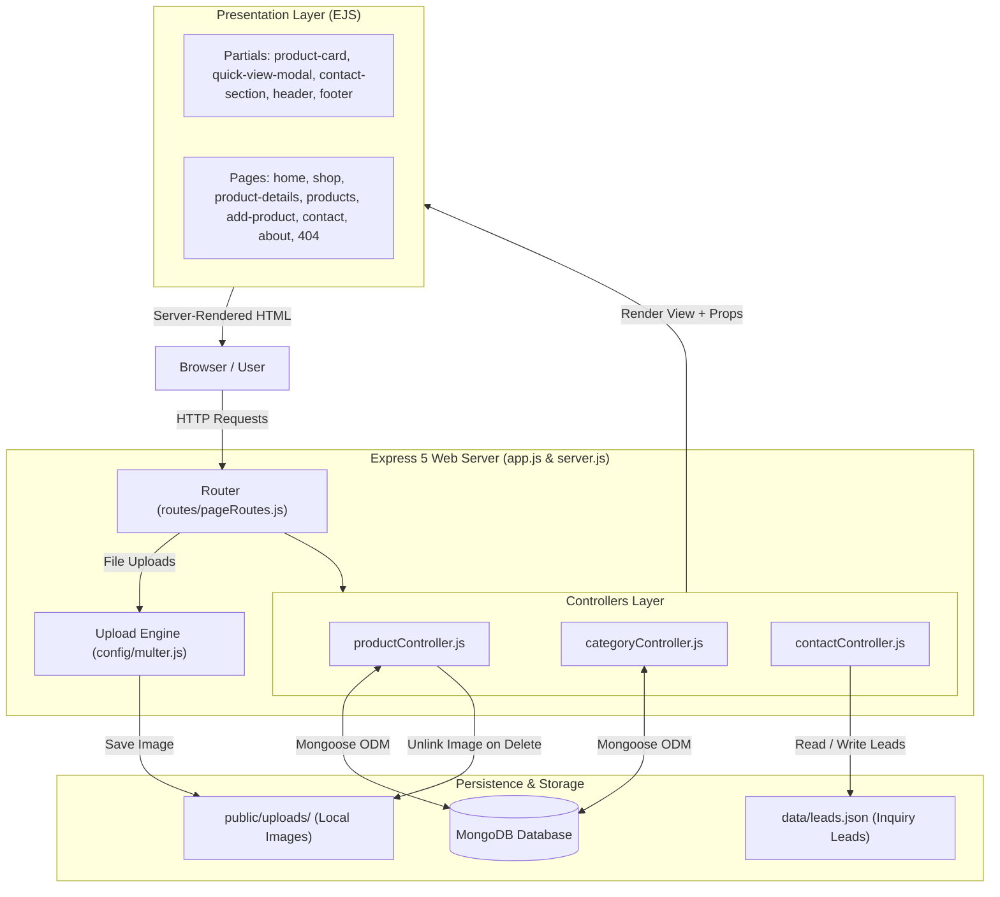

<div align="center">

# 🛒 Cartivo

**Manage smarter. Trade seamlessly. Grow with clarity.**  
*A modern marketplace & back-office inventory platform built with Node.js, Express 5, MongoDB, and EJS.*

[](https://nodejs.org/)
[](https://expressjs.com/)
[](https://mongoosejs.com/)
[](https://ejs.co/)
[](https://tailwindcss.com/)
[](LICENSE)

<br />

[System Overview](#-system-overview) •
[Key Features](#-key-features) •
[How It Works](#-how-the-system-works) •
[Architecture & Tech Stack](#-architecture--technology-stack) •
[Project Structure](#-project-structure) •
[Routes & Endpoints](#-routes--navigation) •
[Database Schemas & Persistence](#-database-schemas--data-models) •
[Quick Start & Seeding](#-quick-start)

---

</div>

## 📖 System Overview

**Cartivo** is a full-stack web application that combines a customer-facing e-commerce marketplace with an administrative inventory back-office. Designed with a Scandinavian minimalist aesthetic and 3D floating clay elements, Cartivo provides a cohesive experience for browsing, searching, previewing products, submitting business inquiries, and managing catalog stock.

The application follows an **ES Module (ESM)** architecture, separating concerns into controllers, Mongoose models, database seeders, configuration modules, reusable EJS view partials, and a responsive frontend styling engine.

---

## ✨ Key Features

### 🛍️ Storefront & Customer Experience
- **Interactive Category Slider**: Homepage carousel featuring drag-to-scroll, touch swipe, smooth momentum, and auto-disabling navigation arrow controls.
- **Dynamic Search & Filtering**: Server-side product search via `$regex` and category filtering via slug query parameters (`/shop?search=...&category=...`), plus client-side instant search filtering.
- **Modular Product Cards**: Reusable product card component with hover zoom, stock indicator dots, currency formatting, and quick view triggers.
- **Interactive Quick View Modal**: Instant product modal popup displaying full description, stock status, and dynamic cart insertion without page reloads.
- **Client-Side Cart with LocalStorage**: Persistent cart state tracking item count and cart badges across views.
- **SEO-Friendly Slugs**: Human-readable URLs (`/product/:slug/view`) generated automatically with `slugify`.
- **Global Contact & Leads System**: Inquiry intake form with phone and topic selection, paired with interactive Google Maps and office visit details. Lead inquiries are logged to `data/leads.json` with timestamped tracking.

### 📦 Back-Office Inventory Hub
- **Executive Metric Cards**: Real-time counters showing total catalog products, active items, and low-stock alerts (< 5 units).
- **Tabular Catalog View**: Administrative table showing product thumbnails, populated category relationships, pricing, stock count, and active/inactive status badges.
- **Structured Intake Form**: Dedicated product creation interface with category relational dropdowns, condition toggles, and metadata flags.
- **Multer File Uploads & Automatic File Cleanup**: Multipart image uploads with size restrictions (2 MB) and MIME type validation. Deleting a product automatically unlinks and removes its image from the disk (`public/uploads/`).
- **Idempotent Database Seeders**: CLI seeder scripts (`npm run seed:categories`, `npm run seed:products`) with bulk upsert operations to bootstrap development environments.

---

## ⚙️ How the System Works



### 1. Request Lifecycle & Routing
Incoming requests pass through Express middleware (URL-encoded body parser, JSON body parser, and static assets from `/public`). A custom middleware injects `res.locals.currentPath = req.path` to highlight active navigation items across the header pill menu.

### 2. Product Catalog & Storefront Flow
- **Home Page (`/`)**: Fetches active products and categories from MongoDB. Renders the category slider, featured product grid, and the contact section.
- **Shop Page (`/shop`)**: Reads optional `?search=` and `?category=` query strings. If a category slug is provided, it resolves the `Category` document and filters products by `category_id`. Populates category names and sorts newest first.
- **Quick View Modal**: When `.quick-view-btn` is clicked, client-side JavaScript (`public/js/shop.js`) captures data attributes from the product card, populates the modal DOM elements, locks background scrolling, and applies the `.active.open` state.

### 3. Inventory Management Flow
- **Adding a Product (`POST /create-product`)**: Multer parses the multipart payload, validates the MIME type (`jpg`, `png`, `webp`) and file size (≤ 2 MB), saves the image to `public/uploads/`, and stores the relative path (`/uploads/filename`). Mongoose automatically generates a clean URL slug from the product title using a `pre('validate')` hook.
- **Deleting a Product (`POST /product/:id/delete`)**: Resolves the product, unlinks the physical image from `public/uploads/` via `fs.unlink`, and removes the MongoDB document via `findOneAndDelete`.

### 4. Lead Capture Flow
When a user submits the contact form (`POST /contact`), [`controllers/contactController.js`](controllers/contactController.js) validates the payload, reads [`data/leads.json`](data/leads.json), appends the new timestamped lead object, and writes the JSON back to disk. It inspects the `Referer` header to redirect the user back to their origin page (`/?success=true#contact` or `/contact?success=true`) to display a success confirmation banner.

---

## 🛠 Architecture & Technology Stack

| Layer | Technology | Version | Purpose |
| :--- | :--- | :--- | :--- |
| **Runtime** | [Node.js](https://nodejs.org/) | v18+ | JavaScript runtime executing in ES Module mode (`"type": "module"`) |
| **Framework** | [Express.js](https://expressjs.com/) | `^5.3.0` | Routing, request parsing, and middleware pipeline |
| **Database** | [MongoDB](https://www.mongodb.com/) | v6+ | NoSQL document storage for products and categories |
| **ODM** | [Mongoose](https://mongoosejs.com/) | `^9.11.4` | Data modeling, validation schemas, and relational population |
| **File Storage** | [Multer](https://github.com/expressjs/multer) | `^2.5.0` | Multipart form handler for product image uploads |
| **Slug Generator**| [Slugify](https://github.com/simov/slugify) | `^1.6.9` | Automatic URL-safe slug creation for products and categories |
| **View Engine** | [EJS](https://ejs.co/) | `^7.0.2` | Templating engine with partial component modularization |
| **Styling** | Tailwind CSS & Custom CSS | — | Responsive utility classes with 3D ambient claymorphic design |
| **Icons & Fonts**| FontAwesome 6 & Google Fonts | — | Plus Jakarta Sans, Inter, and FontAwesome vector icons |
| **Dev Tools** | [Nodemon](https://nodemon.io/) & [Dotenv](https://github.com/motdotla/dotenv) | — | Hot reload development server and environment configuration |

---

## 📁 Project Structure

```text
Cartivo/
├── config/
│   ├── db.js                     # MongoDB connection initialization via Mongoose
│   └── multer.js                 # Disk storage, 2MB limit, and image fileFilter
├── controllers/
│   ├── categoryController.js     # Category retrieval and admin API handlers
│   ├── contactController.js      # Lead submission and leads.json storage engine
│   └── productController.js      # Storefront queries, stock counters, CRUD, image unlinking
├── data/
│   └── leads.json                # In-memory / persistent JSON database for inquiry leads
├── models/
│   ├── Category.js               # Category Mongoose schema (name, slug, icon, status)
│   └── Product.js                # Product Mongoose schema (slug, category_id ref, stock, status)
├── public/
│   ├── css/
│   │   └── cartivo-theme.css     # 3D clay styles, glassmorphism, no-scrollbar, animations
│   ├── js/
│   │   └── shop.js               # Client cart counter, category slider, live search, quick view
│   └── uploads/                  # Uploaded product image files
├── routes/
│   └── pageRoutes.js             # Express router declarations and endpoint bindings
├── seeders/
│   ├── categorySeeder.js         # Bulk upsert seeder for default marketplace categories
│   └── productSeeder.js          # Catalog seeder mapping products to category ObjectIds
├── views/
│   ├── admin/
│   │   └── categories/
│   │       └── categories.ejs    # Admin categories management placeholder
│   ├── partials/
│   │   ├── bottomBanner.ejs      # Reusable bottom CTA promotional banner
│   │   ├── contact-section.ejs   # Global 2-column contact form + Google Maps card
│   │   ├── footer.ejs            # Unified platform footer
│   │   ├── footercdns.ejs        # Footer script assets placeholder
│   │   ├── headcdns.ejs          # Meta tags, fonts, Tailwind CDN, and theme styles
│   │   ├── header.ejs            # Navigation bar with active route matching and cart pill
│   │   ├── product-card.ejs      # Global product card with zoom, details, and add-to-cart
│   │   └── quick-view-modal.ejs  # Global preview modal with stock status and quick add
│   ├── 404.ejs                   # Branded 404 error recovery page
│   ├── about.ejs                 # Company, mission, and architecture overview
│   ├── add-product.ejs           # Product intake form with category selection
│   ├── contact.ejs               # Contact page embedding the global contact section
│   ├── edit-product.ejs          # Product edit interface placeholder
│   ├── home.ejs                  # Storefront landing page with slider and live inventory
│   ├── product-details.ejs       # Individual product specification showcase
│   ├── products.ejs              # Back-office inventory dashboard table and statistics
│   └── shop.ejs                  # Full product catalog with search, cart, and quick view
├── .env.example                  # Environment variable configuration template
├── .gitignore                    # Git exclusions (node_modules, .env, uploads)
├── app.js                        # Express application instance, middleware, and routes mount
├── package.json                  # Dependencies, scripts, and module settings
├── README.md                     # Comprehensive project documentation
└── server.js                     # Server entrypoint: DB connection and port listener
```

---

## 🧭 Routes & Navigation

| Method | Endpoint | Controller Handler | Description | View / Response |
| :--- | :--- | :--- | :--- | :--- |
| `GET` | `/` | `getHomeProducts` | Storefront homepage with category slider & live products | `views/home.ejs` |
| `GET` | `/shop` | `getShopProducts` | Storefront catalog with server-side `?search=` and `?category=` | `views/shop.ejs` |
| `GET` | `/products` | `getProducts` | Back-office inventory dashboard and stock statistics | `views/products.ejs` |
| `GET` | `/product/new` | `getAddProductPage` | Form interface to add a new product with category dropdown | `views/add-product.ejs` |
| `POST` | `/create-product` | `createProduct` | Handles Multer image upload, auto-generates slug, creates product | Redirects to `/products` |
| `GET` | `/product/:slug/view` | `getProductDetails` | Detailed view for a single product resolved by slug | `views/product-details.ejs` |
| `POST` | `/product/:id/delete` | `deleteProduct` | Deletes product document and unlinks image from uploads | Redirects to `/products` |
| `GET` | `/about` | Inline `(req, res)` | About Cartivo platform information | `views/about.ejs` |
| `GET` | `/contact` | `getContact` | Contact page embedding global contact form and HQ map | `views/contact.ejs` |
| `POST` | `/contact` | `submitContact` | Saves lead inquiry to `data/leads.json` and redirects with feedback | Origin URL + `?success=true` |
| `ANY` | `*` | 404 Handler | Fallback for undefined routes | `views/404.ejs` |

---

## 🗄 Database Schemas & Data Models

### 1. Category Schema (`models/Category.js`)
```javascript
{
  name:   { type: String, required: true, trim: true },
  slug:   { type: String, unique: true, lowercase: true, trim: true },
  icon:   { type: String, required: true }, // e.g., 'fa-solid fa-laptop'
  status: { type: String, enum: ["active", "inactive"], default: "active" },
  timestamps: true
}
```
*Note: Category slugs are automatically computed from the `name` field using a `pre('validate')` hook.*

### 2. Product Schema (`models/Product.js`)
```javascript
{
  name:        { type: String, required: true, trim: true },
  slug:        { type: String, unique: true, lowercase: true, trim: true },
  description: { type: String, required: false },
  image:       { type: String, required: false }, // e.g., '/uploads/1793789208073-233194536.png'
  price:       { type: Number, required: true },
  category_id: { type: mongoose.Schema.Types.ObjectId, ref: "Category", required: true },
  stock:       { type: Number, default: 0 },
  condition:   { type: String, required: false }, // e.g., 'New', 'Used', 'Refurbished'
  features:    { type: String, required: false },
  status:      { type: String, enum: ["active", "inactive"], default: "active" },
  timestamps:  true
}
```
*Note: Relational population connects `category_id` to the `Category` model across all queries.*

### 3. Contact Lead Model (`data/leads.json`)
```json
[
  {
    "id": "1793774019183",
    "name": "Sarah Jenkins",
    "email": "sarah@example.com",
    "phone": "+1 (555) 234-5678",
    "subject": "General Inquiry",
    "message": "Interested in enterprise wholesale inventory onboarding.",
    "createdAt": "2026-11-04T11:35:00.000Z"
  }
]
```

---

## 🚀 Quick Start

### 1. Prerequisites
Ensure the following tools are installed:
- [Node.js](https://nodejs.org/) (v18.0.0 or higher)
- [npm](https://www.npmjs.com/) (v9.0.0 or higher)
- [MongoDB Community Server](https://www.mongodb.com/try/download/community) running locally on port `27017` (or a remote MongoDB Atlas URI)

### 2. Clone the Repository
```bash
git clone https://github.com/harisnaveed/Cartivo.git
cd cartivo
```

### 3. Install Dependencies
```bash
npm install
```

### 4. Configure Environment Variables
Copy `.env.example` to create your local `.env`:

```bash
# Windows (PowerShell)
Copy-Item .env.example .env

# macOS / Linux
cp .env.example .env
```

Verify your `.env` configuration:
```env
PORT=3000
HOST=127.0.0.1
MONGODB_URI=mongodb://127.0.0.1:27017/cartivo
```

### 5. Seed the Database
Populate standard marketplace categories and sample catalog products:

```bash
# Step 1: Seed active categories (Electronics, Mobile Phones, Gaming, etc.)
npm run seed:categories

# Step 2: Seed products linked to the active categories
npm run seed:products
```

### 6. Run the Application

#### Development Mode (with hot-reload):
```bash
npm run dev
```

#### Production Mode:
```bash
npm start
```

Visit the application in your browser:
```text
http://localhost:3000
```

---

## 📄 License

This project is licensed under the [ISC License](LICENSE).

<div align="center">
  <sub>Built with ❤️ for elegant e-commerce and back-office inventory operations.</sub>
</div>
